# Pipeline CI/CD de la capa (un repositorio por capa)

Cada repositorio (System, Process, Experience) tiene su propio pipeline, con **los mismos archivos**. Lo único que cambia entre repos es `.github/pipeline-config.env` (4 líneas) y la carpeta `policies/` (solo Experience).

## Flujo

```mermaid
flowchart LR
  PR["Pull request"] --> T["Build, MUnit 80% y compuertas estáticas"]
  T -->|"checks + aprobación de otra persona"| M["Merge a main"]
  M --> B["Build único, versión X.Y.N"]
  B --> R["Release inmutable + SHA256SUMS"]
  R --> DEV["Dev: verificación y plan (simulado)"]
  DEV --> QA["Deploy qa (Sandbox, real)"]
  QA --> AP{{"Aprobación manual: aprobador distinto del autor"}}
  AP --> PROD["Prod: verificación y plan (simulado)"]
```

Un cambio en el repo de una capa solo compila, publica y despliega **esa** capa. Las demás no se tocan.

## Configuración de cada capa (`.github/pipeline-config.env`)

| Capa | `APP_NAME` | `VALIDATE_FLAGS` | `APPLY_POLICIES` | `RUN_SMOKE_TEST` |
|---|---|---|---|---|
| Experience | `transfers-experience-api` | `--require-autodiscovery` | `true` | `true` |
| Process | `payment-order-process` | `--require-idempotency` | `false` | `false` |
| System | `core-transfers-system` | (vacío) | `false` | `false` |

- `APP_NAME` es el nombre base de la app en CloudHub; el pipeline le añade `-<ambiente>` (por ejemplo `transfers-experience-api-qa`).
- Solo Experience está expuesta y gestionada en API Manager: lleva políticas, autodiscovery y prueba de humo. System y Process son internas.

## Alcance con la cuenta trial

La cuenta gratuita solo permite desplegar en el ambiente **Sandbox**, que se usa como **qa**. El ambiente Design no admite despliegues. Por eso solo `qa` se despliega de verdad. `dev` y `prod` siguen en el pipeline en modo simulación. Lo controla una línea en `deploy.yml`: `LIVE_ENVS: "qa"`.

| Paso | dev | qa | prod |
|---|---|---|---|
| Pausa por aprobación del environment (revisores, *Prevent self-review*, solo `main`) | No lleva | No lleva | Sí, real |
| Separación de funciones (`check-approvers.sh`) | — | — | Sí, real |
| Descarga de la release y verificación de SHA-256 | Real | Real | Real |
| Validación de configuración del ambiente | Real | Real | Real (réplicas ≥ 2) |
| Políticas, despliegue y prueba de humo | Simulado | **Real** | Simulado |

Simulado quiere decir que el log muestra el plan (`SIMULACIÓN: …`) y no se llama a Anypoint.

Decisión de alcance para el README: lo que la prueba evalúa (promover el mismo artefacto, que nadie despliegue a producción sin aprobación y que el aprobador no sea el autor) se ejecuta de verdad. Solo se omiten las llamadas a Anypoint en los ambientes sin capacidad.

## Cómo se cumple cada requisito

| Requisito | Mecanismo | Dónde |
|---|---|---|
| Compila, prueba y falla por cobertura | `mvn verify` con MUnit `failBuild=true` y 80 %. `validate_project.py` falla el build si alguien desactiva el umbral | `ci-cd.yml`, `pom-snippets.xml`, `scripts/validate_project.py` |
| Artefacto versionado | Versión `X.Y.N` (N = número de ejecución), sin `SNAPSHOT`, publicada como GitHub Release con `SHA256SUMS`. El tag no se puede reemplazar | `publish` en `ci-cd.yml` |
| Mismo artefacto a dev, qa y prod | Se compila una vez; cada ambiente descarga el `.jar` de la release y verifica su SHA-256. En qa se despliega con `mule:deploy` (sin recompilar) | `deploy.yml`, `scripts/deploy-app.sh` |
| Identidad de servicio | Connected App de Anypoint con *client credentials*, guardada como secreto del environment | `deploy.yml`, `.github/maven-settings.xml` |
| Políticas como código (Experience) | JSON versionado y aplicado por la API REST de API Manager (idempotente, avisa de deriva) | `policies/`, `scripts/apply-policies.sh` |
| Aprobación manual antes de prod | Environment `prod` con revisores obligatorios; los secretos de prod solo se liberan tras aprobar | `deploy.yml` |
| Aprobador distinto del autor | "Prevent self-review" más `check-approvers.sh` (compara aprobadores con autores de commits y del PR) | `scripts/check-approvers.sh` |
| Sin credenciales en texto plano | Secretos del environment, Secure Properties en la app, escaneo del pom y de los YAML | `scripts/validate_project.py` |

## Configuración en GitHub (en cada repositorio)

La configuración de GitHub es **por repositorio**: se repite en los tres.

**Colaboradores:** la persona que aprueba (revisora) con permiso de escritura.

**Secretos del repositorio**
- `EXCHANGE_CLIENT_ID` y `EXCHANGE_CLIENT_SECRET`: Connected App de solo lectura (scope Exchange Viewer).
- `MULE_KEY_TEST`: llave de pruebas, distinta de la de cualquier ambiente.

**Variable del repositorio:** `ANYPOINT_ORG_ID`. Opcional: `JAVA_VERSION`.

**Environment `qa`** (despliegue real en Sandbox)

| Tipo | Nombre | Valor | ¿Qué capas? |
|---|---|---|---|
| Secreto | `ANYPOINT_CLIENT_ID`, `ANYPOINT_CLIENT_SECRET` | Connected App de Sandbox | Todas |
| Secreto | `MULE_SECURE_KEY` | Llave de cifrado de las Secure Properties de ese ambiente | Todas |
| Variable | `ANYPOINT_ENVIRONMENT` | `Sandbox` | Todas |
| Variable | `CH2_TARGET` | Nombre del espacio de CloudHub 2.0 | Todas |
| Variable | `CH2_REPLICAS`, `CH2_VCORES` | `1` y `0.1` | Todas |
| Variable | `MULE_RUNTIME` | Por ejemplo `4.6.0` | Todas |
| Variable | `API_INSTANCE_ID_EXPERIENCE` | Id de la instancia de API de Experience | Solo Experience |
| Variable | `EXPERIENCE_URL` | URL base de la Experience API, hasta `/api` | Solo Experience |
| Variable | `RATE_LIMIT_PROBE_REQUESTS` | `560` | Solo Experience |
| Secreto | `SMOKE_CLIENT_ID`, `SMOKE_CLIENT_SECRET` | Aplicación cliente de la prueba de humo (con contrato en API Manager) | Solo Experience |

**Environments `dev` y `prod` (simulación):** `dev` no necesita nada. `prod` solo necesita `CH2_REPLICAS` con valor `2` (el pipeline valida la regla de réplicas).

**Capacidad:** 3 apps × 0.1 vCore = 0.3 vCore en qa. Revisa en Runtime Manager cuánto permite tu trial.

**Protecciones (en cada repo)**
- **`prod`:** revisores obligatorios, *Prevent self-review* activado, ramas permitidas solo `main` y sin bypass para administradores.
- **`dev` y `qa`:** ramas permitidas solo `main`, sin revisores.
- **Rama `main` (ruleset):** PR obligatorio, 1 aprobación como mínimo, descartar aprobaciones obsoletas, exigir aprobación del último push, check `Build & test` obligatorio, sin force push y sin bypass.
- **CODEOWNERS** sobre `.github/`, `scripts/` y `policies/`.
- **Plan de GitHub:** la documentación es ambigua sobre revisores obligatorios en repositorios privados según el plan. Confírmalo en *Settings → Environments*.

## Configuración en Anypoint

1. Una **Connected App para Sandbox** (qa) con permisos mínimos: desplegar y leer aplicaciones en Runtime Manager, gestionar políticas en API Manager y leer Exchange. La misma sirve para los tres repos.
2. **Una instancia de API para Experience en Sandbox** (con *Autodiscovery*). Su id va en `API_INSTANCE_ID_EXPERIENCE` y en `api.autodiscovery.apiId` de `secure-qa.yaml`. En `dev` y `prod`, que no se despliegan, pon valores provisionales y distintos (`DEV-PENDIENTE`, `PROD-PENDIENTE`): el validador exige que la clave exista y no se repita entre ambientes.
3. **Políticas (solo Experience):** configura *Client ID Enforcement* y *Rate Limiting* en la instancia, corre `scripts/export-policies.sh experience` y commitea el resultado en `policies/experience/`. Los JSON de la carpeta son plantillas: `apply-policies.sh` se niega a correr en modo real mientras tengan `REPLACE`.

## Orden de despliegue entre capas

Cada repo despliega por separado. Experience llama a Process y Process llama a System, así que **la primera vez** hay que desplegar de abajo hacia arriba: System, Process y Experience. Después cada capa se actualiza de forma independiente.

La URL interna de System la necesita Process, y la de Process la necesita Experience. Esas URLs solo se conocen tras desplegar la capa de abajo, y la release es inmutable (la configuración va dentro del `.jar`). Por eso la primera vez:

1. Despliega a mano **System** y **Process** en Sandbox, con el nombre exacto que usa el pipeline: `core-transfers-system-qa` y `payment-order-process-qa`. Si el nombre no coincide, el pipeline creará una app nueva y consumirá vCores.
2. Copia el endpoint interno de cada una y complétalo en la configuración de la capa que la consume (la propiedad que hoy está como `#pendiente`), en qa. En dev y prod deja un valor provisional.
3. Sube el cambio por PR. Desde ese momento el pipeline despliega cada capa sin intervención manual.

## Qué verificar en la primera ejecución

No pude probar contra Anypoint ni GitHub. Probé en local la validación de configuración, la verificación de aprobador, la aplicación de políticas, el modo simulación y el nombre de la app en el despliegue. Verifica esto:

1. **`mule:deploy` usa el `.jar` copiado en `target/`.** El log debe mostrar `…-X.Y.N-mule-application.jar`.
2. **La compuerta de cobertura falla de verdad.** En una rama de prueba sube `requiredApplicationCoverage` a 99 y comprueba que el PR falla.
3. **Rutas de la API de Anypoint** que usan los scripts (token, lista de ambientes y políticas de API Manager): son las estándar, pero no las validé contra tu tenant.
4. **JDK y runtime coherentes:** `JAVA_VERSION` debe corresponder al runtime del pom (4.4 y 4.5: 8 u 11; 4.6 en adelante: 17).
5. **`github.event.before`** llega al job de despliegue. Si el check de aprobadores solo ve un commit, revisa ese paso.
6. **Simulación de prod.** Aprueba con otra cuenta y comprueba que el log dice `SIMULACIÓN` y que `check-approvers.sh` pasa. Luego intenta aprobar con la misma persona que hizo el cambio y comprueba que se bloquea. Es la evidencia para la defensa.

## Activar otro ambiente (dev o prod)

1. Añade el ambiente a `LIVE_ENVS` en `deploy.yml`, por PR y con revisión (por ejemplo `"dev qa"`).
2. En su environment de GitHub carga los secretos y variables de la tabla. En prod, `CH2_REPLICAS` ≥ 2 y `RATE_LIMIT_PROBE_REQUESTS` vacío.
3. Crea su instancia de API de Experience, pon el id real en su `secure-<env>.yaml` y completa su `rate-limiting.<env>.json`.
4. Si dev comparte Sandbox con qa, las apps se distinguen por el sufijo `-dev` y `-qa`, y cada una necesita su propia instancia de API.

## Mejoras posibles

Fijar las acciones por SHA de commit, firmar los artefactos con attestations, y automatizar el rollback si la prueba de humo falla (hoy se hace con `rollback.yml`, que exige aprobación).
